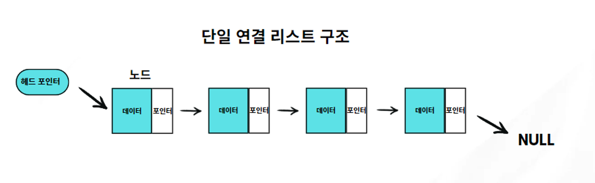
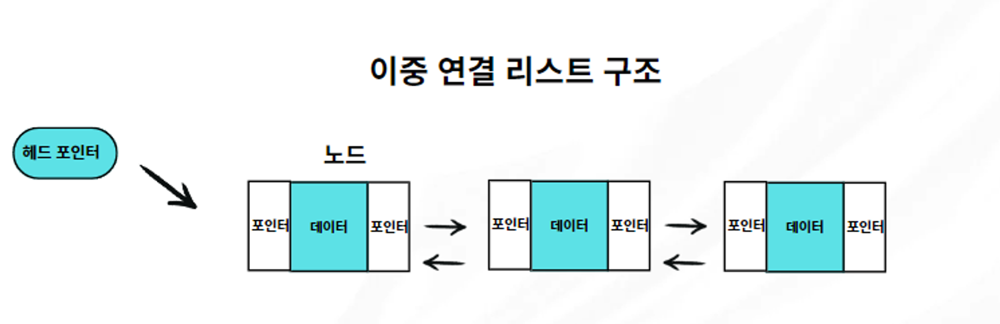
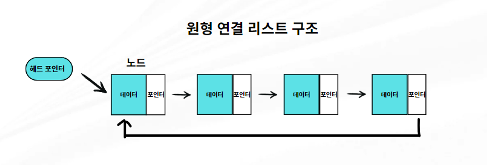
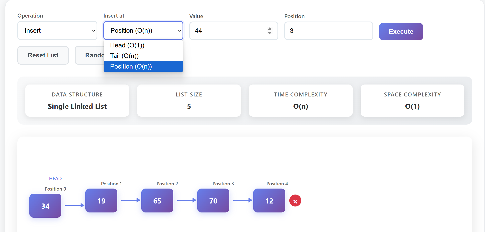

## 단일 연결 리스트

한 요소가 다음 요소를 가리키는 구조를 갖고 있다.

각 요소들은 각자의 데이터, 다음 요소의 주소값을 갖고 있다.






출처: https://velog.io/@sunset_1839

연결 리스트는 배열과 달리 첫 요소부터 중간의 모든 요소들을 거쳐야 원하는 번호의 요소에 도달할 수 있다는 특징이 있다.

따라서 특정 위치의 값에 접근하는 과정은 배열보다 많은 연산이 발생한다.

추가/제거 작업에서는 요소가 가리키는 요소를 그 다음 요소로 바꿔주기만 하면 된다. 배열처럼 그 뒤의 값을 당겨오거나 추가적인 과정이 필요하지 않기 때문에 배열보다 빠르다. 하지만 해당 위치까지는 어쨌든 첫 요소부터 연결을 거쳐가야 하므로 그만큼의 연산이 발생한다.

즉, 추가/제거할 값을 찾기까지는 시간이 걸리지만, 추가/제거 작업 자체는 배열보다 빠르다.

### Insert(추가)

연결리스트에서 head는 리스트의 첫 번째 요소(노드)를, tail은 마지막 요소(노드)를 가리킨다.

head는 리스트의 시작점을 알리고, tail은 리스트의 끝을 나타내며, tail의 포인터는 보통 null 값을 가진다.

특정 position에 있는 노드를 찾을 때 head에서 시작해 순차적으로 노드를 따라가는 방식으로 이루어진다.



따라서 첫 번째 자리에 추가하는 것은 O(1)의 시간 복잡도다. 그 외(tail, position)에는 첫 번째 노드부터 해당 노드 위치까지 이동해야 하므로 O(n)의 시간 복잡도를 가진다.

### Delete(삭제)

value는 각 노드에 실제로 저장되는 데이터, index는 배열과 같다. 여기서 저장되는 데이터, 그리고 index로 이동하기 위해서는 모두 첫 번째 노드부터 순서대로 해당 데이터를 찾아야 하므로 모두 O(n)의 시간 복잡도를 갖게 된다.

### 파이썬 코드 예시

```python
# 연결 리스트의 각 요소를 나타내는 클래스
class Node:
  def __init__(self, data):
    # 각 노드는 요소에 담기는 값인 data속성과
    self.data = data
    # 다음 요소를 가리키는 next 속성이 있다.
    self.next = None

# 만들어진 Node를 다룰 Singly Linked List 클래스
class SinglyLinkedList:
  # 첫 번째 요소를 저장할 head 속성
  def __init__(self):
    self.head = None

  # 헤드에 노드를 추가하는 메소드
  def insert_at_head(self, data):
    # 매개변수로 데이터를 받아와서 이 값을 담은 새 노드를 만든다.
    new_node = Node(data)

    # 생성된 새 노드에 기존 헤드 데이터를 next로 설정한다.
    # 만약 기존 헤드 데이터가 없다면 빈 값이고, 있다면 요소들 중 첫번째 요소를 가리킨다.
    new_node.next = self.head
    # 이 노드를 새로운 헤드값으로 바꿔준다.
    self.head = new_node

  # 주어진 위치에 요소를 추가하는 메소드
  def insert_at_position(self, data, position):
    if position == 0:
      self.insert_at_head(data)
      return
    new_node = Node(data)
    current = self.head
    for _ in range(position - 1):
      if current is None:
        return  # position out of bounds
      current = current.next
    if current is None:
      return
    new_node.next = current.next
    current.next = new_node

  def delete(self, key):
    current = self.head
    prev = None
    while current:
      if current.data == key:
        if prev:
          prev.next = current.next
        else:
          self.head = current.next
        return
    prev = current
    current = current.next

  def search(self, key):
    current = self.head
    while current:
      if current.data == key:
        return True
      current = current.next
    return False

  def traverse(self):
    current = self.head
    while current:
      print(current.data, end=" -> ")
      current = current.next
    print("None")

ll = SinglyLinkedList()

ll.insert_at_head(17)
ll.insert_at_head(18)
ll.insert_at_head(19)
ll.insert_at_head(76)
ll.insert_at_head(44)


ll.insert_at_position(34, 3)

ll.delete(18)

print(ll.search(19)) # True

ll.traverse()
# 44 -> 76 -> 19 -> 34 -> 17 -> None
```

### 자바 코드 예시

```java
// 연결 리스트의 각 요소를 나타내는 클래스
class Node {
  // 각 노드는 요소에 담기는 값인 data속성과
  int data;
  // 다음 요소를 가리키는 next 속성이 있다.
  // 다음 노드의 주소가 이전 노드의 next 속성 값으로 들어간다.
  Node next;
  // Node의 생성자
  Node(int data) {
    // 매개변수로 저장될 값을 data에 받는다.
    this.data = data;
    // next는 빈 값으로 초기화
    this.next = null;
  }
}

// 만들어진 Node를 다룰 Singly Linked List 클래스
public class SinglyLinkedList {
  // 첫 번째 요소를 저장할 head 속성
  Node head;

  // 헤드에 노드를 추가하는 메소드
  public void insertAtHead(int data) {
    // 매개변수로 데이터를 받아와서 이 값을 담은 새 노드를 만든다.
    Node newNode = new Node(data);
    // 생성된 새 노드에 기존 헤드 데이터를 next로 설정한다.
    // 만약 기존 헤드 데이터가 없다면 빈 값이고, 있다면 요소들 중 첫번째 요소를 가리킨다.
    newNode.next = head;
    // 이 노드를 새로운 헤드값으로 바꿔준다.
    head = newNode;
  }

  // 주어진 위치에 요소를 추가하는 메소드
  public void insertAtPosition(int data, int position) {
    if (position == 0) {
      insertAtHead(data);
      return;
    }
    Node newNode = new Node(data);
    Node current = head;
    for (int i = 0; i < position - 1 && current != null; i++) {
      current = current.next;
    }
    if (current == null) return;
    newNode.next = current.next;
    current.next = newNode;
  }

  public void delete(int key) {
    Node current = head, prev = null;
    while (current != null) {
      if (current.data == key) {
        if (prev != null) {
          prev.next = current.next;
        } else {
          head = current.next;
        }
        return;
      }
      prev = current;
      current = current.next;
    }
  }

  public boolean search(int key) {
    Node current = head;
    while (current != null) {
      if (current.data == key) return true;
      current = current.next;
    }
    return false;
  }

  public void traverse() {
    Node current = head;
    while (current != null) {
      System.out.print(current.data + " -> ");
      current = current.next;
    }
    System.out.println("null");
  }

  public static void main(String[] args) {

    SinglyLinkedList ll = new SinglyLinkedList();

    ll.insertAtHead(17);
    ll.insertAtHead(18);
    ll.insertAtHead(19);
    ll.insertAtHead(76);
    ll.insertAtHead(44);

    ll.insertAtPosition(34, 3);

    ll.delete(18);

    System.out.println(ll.search(19)); // true

    ll.traverse();
    // 44 -> 76 -> 19 -> 34 -> 17 -> null
  }
}
```
